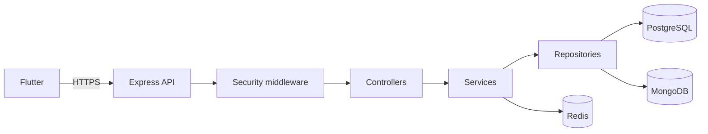

# LifeStyle App

A personal productivity app built around one question: **what should I focus on
today?** Tasks, habits, notes, money and reminders in one connected system rather
than five separate mini-apps.

## Status

| Part | State |
|---|---|
| Backend foundation | Working. Config, errors, logging, security, databases, migrations |
| Authentication | Complete. Register, login, refresh with rotation, logout, password change |
| Database schema | Complete for the MVP. 14 tables, constraints and indexes applied |
| Projects and tasks | Complete. CRUD, filters, cursor pagination, start/stop timer |
| Notes | Complete. CRUD, tags, search, archive, links to projects and tasks |
| Habits | Complete. Daily and weekly streaks, history, archive |
| Goals | Complete. Milestones, progress, milestones backed by tasks |
| Money | Complete. Expenses, reports, subscriptions, budgets with live spending |
| Events and reminders | Complete. Calendar windows, all-day events, a pull-based reminder queue |
| Dashboard | Complete. One request for today's tasks, habits, events, reminders, spending and goals |
| Deployment | Container, Railway config and runbook written. Not yet deployed |
| Flutter app | Not started |

**704 tests.** Every one of them runs somewhere:

| Where | Result |
|---|---|
| CI, with PostgreSQL 16, MongoDB 7 and Redis 7 | 698 pass, 6 skip |
| A local machine with all three databases | 698 pass, 6 skip, about 96 seconds |
| A local machine with no MongoDB | 649 pass, 55 skip |

The two skipped sets are mutually exclusive by design. The 55 are the note
suites, which need a real MongoDB. The 6 prove that notes degrade to 503 when
MongoDB is absent, which can only be tested when it is absent. Neither set is
missing coverage; each runs where it is meaningful.

Type check, lint, format, build and `npm audit` are clean.

## Tech stack

**Backend.** Node.js, Express, TypeScript in strict mode.
**Databases.** PostgreSQL for relational and financial data, MongoDB for notes
and the audit log, Redis for caching and rate limiting.
**Security.** JWT with rotating refresh tokens, bcrypt, Helmet, CORS, Zod
validation, rate limiting, structured audit trail.
**Client.** Flutter, planned.

Why three databases and what each one is for is explained in
[the database architecture](docs/database/database-overview.md). The short
version: PostgreSQL holds everything relational, MongoDB holds the two entities
that are genuinely document-shaped, and Redis holds nothing that matters if lost.

## Architecture



Feature-based and layered. Each feature owns its controller, service, repository,
routes, validation and types. There is no global folder of every controller.

## Quick start

```bash
cd backend
npm ci
cp .env.example .env     # fill in DATABASE_URL and two JWT secrets
npm run migrate
npm run dev
```

```bash
curl http://localhost:3000/health
```

Only PostgreSQL is required. MongoDB and Redis are optional in development and
the app degrades cleanly without them. Full instructions, including how to
generate secrets, are in [the setup guide](docs/development/setup.md).

## Testing

```bash
npm test                  # everything: the unit tier, then the rest
npm run test:unit         # no database, no network, under a second
npm run test:integration  # needs PostgreSQL
npm run test:security     # needs PostgreSQL
```

Security tests are regression tests for security properties: SQL injection, NoSQL
injection, privilege escalation, JWT forgery, brute force, account enumeration,
information disclosure, and insecure direct object references across tasks,
projects, timer sessions, notes, habits, goals, expenses, subscriptions and
budgets. If one starts failing, a protection has been removed.

## API

Swagger UI runs at `http://localhost:3000/docs` in development. The specification
is [docs/api/openapi.yaml](docs/api/openapi.yaml), and every error code is listed
in [the error contract](docs/api/errors.md).

Current endpoints:

```
POST   /api/v1/auth/register
POST   /api/v1/auth/login
POST   /api/v1/auth/refresh
POST   /api/v1/auth/logout
POST   /api/v1/auth/change-password
GET    /api/v1/auth/me

GET    /api/v1/projects            list, cursor-paginated
POST   /api/v1/projects
GET    /api/v1/projects/:id
PATCH  /api/v1/projects/:id
DELETE /api/v1/projects/:id        tasks survive, ungrouped

GET    /api/v1/tasks               filters: status, priority, project, due, overdue, search
POST   /api/v1/tasks
GET    /api/v1/tasks/:id
PATCH  /api/v1/tasks/:id
DELETE /api/v1/tasks/:id
POST   /api/v1/tasks/:id/timer/start
POST   /api/v1/tasks/:id/timer/stop
GET    /api/v1/tasks/:id/timer/sessions

GET    /api/v1/habits              filters: archived; asOf sets the streak date
POST   /api/v1/habits
GET    /api/v1/habits/:id
PATCH  /api/v1/habits/:id
DELETE /api/v1/habits/:id          history goes too; archive to keep it
GET    /api/v1/habits/:id/logs     filters: from, to
POST   /api/v1/habits/:id/logs     idempotent; returns the recomputed habit
DELETE /api/v1/habits/:id/logs/:date

GET    /api/v1/goals               filters: status
POST   /api/v1/goals
GET    /api/v1/goals/:id           includes the milestone checklist
PATCH  /api/v1/goals/:id
DELETE /api/v1/goals/:id           milestones go too, backing tasks do not
POST   /api/v1/goals/:id/milestones
PATCH  /api/v1/goals/:id/milestones/:milestoneId
DELETE /api/v1/goals/:id/milestones/:milestoneId

GET    /api/v1/expenses            filters: category, currency, from, to
POST   /api/v1/expenses            amounts are strings; see below
GET    /api/v1/expenses/summary    totals per currency and per category
GET    /api/v1/expenses/:id
PATCH  /api/v1/expenses/:id
DELETE /api/v1/expenses/:id

GET    /api/v1/subscriptions            filters: active
POST   /api/v1/subscriptions
GET    /api/v1/subscriptions/upcoming   what bills in the next N days
GET    /api/v1/subscriptions/summary    monthly cost, per currency
GET    /api/v1/subscriptions/:id
PATCH  /api/v1/subscriptions/:id
DELETE /api/v1/subscriptions/:id

GET    /api/v1/budgets             filters: month
POST   /api/v1/budgets             one per category per month
GET    /api/v1/budgets/:id         spending summed live from your expenses
PATCH  /api/v1/budgets/:id
DELETE /api/v1/budgets/:id         the expenses it measured are untouched

GET    /api/v1/dashboard           everything on you today, in one request

GET    /api/v1/events              window: from, to — overlap, not containment
POST   /api/v1/events              linkedType + linkedId attach it to a task or habit
GET    /api/v1/events/:id
PATCH  /api/v1/events/:id          setting allDay snaps the stored times to the UTC day
DELETE /api/v1/events/:id          its reminders go too

GET    /api/v1/reminders           filters: status, entityType, entityId
POST   /api/v1/reminders           for a task, habit, subscription or event
GET    /api/v1/reminders/due       the queue: what has come due, oldest first
GET    /api/v1/reminders/:id
PATCH  /api/v1/reminders/:id       reschedule; status moves through the actions below
POST   /api/v1/reminders/:id/acknowledge   shown; idempotent
POST   /api/v1/reminders/:id/dismiss       done with it; idempotent
POST   /api/v1/reminders/:id/snooze        minutes from now, default 10
DELETE /api/v1/reminders/:id

GET    /api/v1/notes               filters: tag, search, project, task, archived
POST   /api/v1/notes
GET    /api/v1/notes/tags          every tag you have used
POST   /api/v1/notes/reconcile     clears links to deleted projects and tasks
GET    /api/v1/notes/:id
PATCH  /api/v1/notes/:id
DELETE /api/v1/notes/:id

GET    /health  /liveness  /readiness
```

### Money is decimal, and amounts are strings

`{"amount": "1234.50"}`, never `{"amount": 1234.5}`. A JSON number is parsed into
a double, and a double cannot represent 0.10 exactly, so totals drift. Columns are
`NUMERIC(14,2)`, every sum is computed by PostgreSQL, and nothing adds two amounts
in JavaScript. Sending a number with a third decimal place is refused rather than
rounded, because a rounded amount is indistinguishable from a correct one once
stored. Totals are always grouped by currency: 100 USD plus 100 EGP is not 200.

### The home screen is one request, computed fresh

`GET /api/v1/dashboard` answers "what is on me today" across tasks, habits,
events, reminders, money and goals in a single SQL statement — one round trip on
one connection, which matters when the database is in another region.

It is not cached, deliberately. A cached summary has to be dropped by every write
path in every feature, and the first one that forgets shows a home screen that
contradicts the screen the user just came from. That is the same failure a stored
budget counter has, rejected for the same reason. The invalidation calls that
existed before this feature were deleting a key nothing ever wrote — a Redis
round trip on every write in exchange for nothing — and they are gone.

Where a rule already exists, the dashboard imports it rather than restating it:
whether a habit is done for its current period, and which expenses a budget
measures. A second copy of either would not fail loudly, it would drift, and the
symptom would be a home screen quietly disagreeing with the screen it summarises.
The tests assert the agreement, not just the behaviour.

### Reminders are pulled, not pushed

There is no scheduler. `GET /api/v1/reminders/due` returns what has come due,
oldest first, and the client acknowledges, dismisses or snoozes each one. A job
that walked the table and pushed notifications would need a worker, a lock so two
instances do not double-send, a retry policy, and an answer for everything it
missed while it was down — four states that can be wrong with nothing to notice.
Asking has none of them: a phone that was off for a day asks once and gets the
whole backlog in order.

A reminder whose task, habit, subscription or event has been deleted is never
returned as due. There is no foreign key to cascade — the target table is chosen
by a column — so that check is a condition inside the query, where no future
caller can forget it.

### An all-day event is a stored fact, not a flag

Setting `allDay` rewrites the event to cover the whole UTC day, 00:00:00.000Z to
23:59:59.999Z, in the same statement that sets the flag. A flag the backend
ignores is one that two clients interpret two ways, and an event marked all-day
but stored 09:00–10:00 is not on Tuesday's row — it is in Tuesday's nine o'clock
slot. The day is the UTC day; there is no per-user timezone yet, and
[DD-024](docs/architecture/design-decisions.md) says why that is the honest
choice rather than the convenient one.

Calendar windows select an **overlap**: `?from=&to=` returns an event that was
already running when the window opened, so a Monday-to-Friday conference appears
in a query for Wednesday.

## Security

Every response is a deliberate one. Login returns the same answer for an unknown
email and a wrong password, with matched timing. Refresh tokens are single-use
and replaying one revokes the whole session. Requesting another user's task or
project returns 404, not 403, so identifiers cannot be enumerated, and attaching
a task to someone else's project is refused with a message that does not reveal
whether that project exists. Notes add a second query language to defend: every
value reaching MongoDB has passed a Zod schema first, so an operator object such
as `{"$ne": null}` is rejected as the wrong type rather than becoming a query.

The reasoning, threat by threat, is in
[the security overview](docs/security/security-overview.md), and what is and is
not yet covered is in [the checklist](docs/security/security-checklist.md).

Found a vulnerability? Please report it privately rather than opening an issue.

## Documentation

[docs/](docs/README.md) is the index. The two worth reading first are
[design decisions](docs/architecture/design-decisions.md), which records why each
choice was made and what it costs, and
[database architecture](docs/database/database-overview.md).

## Repository layout

```
backend/          Express + TypeScript API
  src/
    config/       validated environment
    core/         errors, logger, middleware, security, container
    infrastructure/  postgres, mongodb, redis
    features/     auth, health, docs
  test/           unit, integration, security
docs/             architecture, database, security, api, development,
                  deployment, troubleshooting
.github/workflows/   CI
.archive/         the discarded Django scaffold, kept only for reference
```

`.archive/` can be deleted. It holds the earlier Django backend, which was
replaced when the stack changed to Node. See decision DD-001.

## Contributing

- TypeScript strict mode. Avoid `any`; the linter rejects it.
- Every feature ships with its validation, authorization, error handling, tests
  and documentation. Not as a follow-up.
- Never leave a TODO in security-critical code.
- Record architectural decisions in the decision log, including the alternatives
  you rejected.
- Never commit `.env`, keys or credentials.
