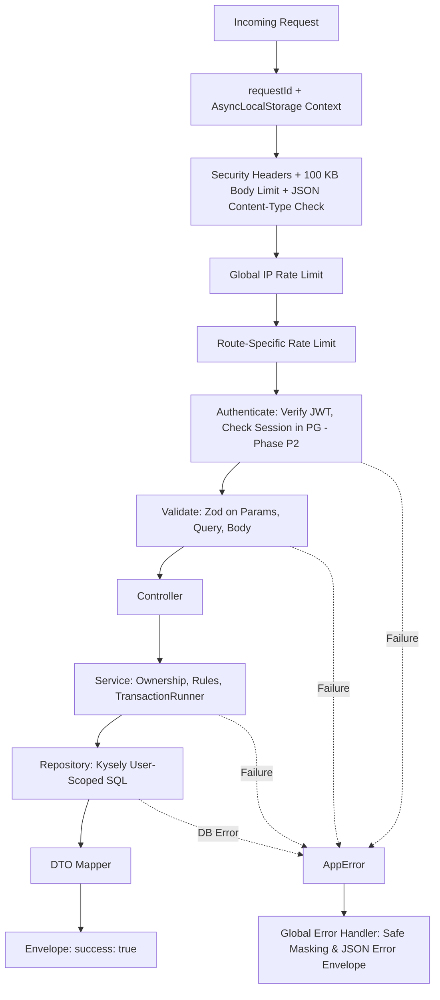

# Backend Architecture & Strict Layering

> **Specification Reference:** Section 4.3–4.6 & ADR-021

## 1. Strict Layering Architecture

Every request travels strictly in one direction through six architectural boundaries:

```text
Route → Middleware → Controller → Service → Repository → PostgreSQL
```

### Layer Rules & Invariants

| Layer | Permitted Actions | Strictly Forbidden |
| :--- | :--- | :--- |
| **Route** | Declares HTTP method, URL path, middleware order (`rateLimit → authenticate → validate`) | Any business rules, input mutations, direct handler logic |
| **Middleware** | Cross-cutting concerns: Request ID, headers, body size checks, auth, Zod validation | Business logic, direct database queries |
| **Controller** | Reads validated input, calls exactly one Service method, returns response envelope | Direct database access, business rules |
| **Service** | Core business rules, ownership checks, transactions (`TransactionRunner`), audit logging | Express `req`/`res` imports, SQL string authoring |
| **Repository** | SQL execution via Kysely; every method receives `userId` first | Business decisions, cross-user unscoped queries |
| **DTO Mapper** | Explicit mapping between database rows and API response schemas | Exposing raw database rows or password hashes |

---

## 2. Request Lifecycle & Flow



---

## 3. Dependency Inversion & Composition Root (ADR-021)

All application components depend strictly on abstract interfaces rather than concrete implementations:
* `Clock` $\rightarrow$ `SystemClock` (production) or `FakeClock` (testing).
* `IdGenerator` $\rightarrow$ `UuidGenerator`.
* `RateLimiter` $\rightarrow$ `RedisRateLimiter` (production) or `MemoryRateLimiter` (testing).
* `TransactionRunner` $\rightarrow$ `PgTransactionRunner`.
* `SessionValidator` $\rightarrow$ `PgSessionValidator`.

All wiring is declared explicitly in `src/container.ts` using manual constructor injection without runtime DI containers.
