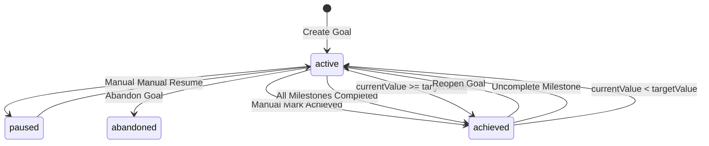

# Architecture Documentation — Goals & Milestones

**Phase:** P7 — Goals & Milestones  
**Status:** Implemented & Verified  
**Date:** 2026-09-28  
**Specification Reference:** LifeStyle App Specification v1.0.1 (Sections 1.4.2, 6.4, 14.9, 18)

---

## 1. Executive Summary

Phase P7 delivers the Goals and Milestones domain of the LifeStyle App. It provides production-ready REST endpoints, domain services, Kysely-based PostgreSQL repositories, and automated progress calculation engines for:
1. **Goals Management (`/api/v1/goals`)**: Long-term objectives supporting two distinct progression paradigms:
   - **Numeric Goals (`numeric`)**: Track quantitative targets with exact 4-decimal precision (`target_value`, `current_value`, `unit`), bounded percentage calculations, and automatic status achievement.
   - **Milestone Goals (`milestones`)**: Track multi-step initiatives through ordered, discrete progress checkpoints.
2. **Milestones Management (`/api/v1/goals/{id}/milestones`)**: Ordered sub-goals with independent due dates, completion lifecycle, and real-time parent progress synchronization.
3. **Automated Lifecycle Transitions**:
   - Marking a goal `'achieved'` sets `achieved_at = NOW()`.
   - Reopening an achieved goal resets `achieved_at = null`.
   - Completing all milestones automatically marks the parent goal `'achieved'`.
   - Uncompleting any milestone on an achieved goal automatically reverts it to `'active'`.
   - Reaching `current_value >= target_value` on numeric goals triggers automatic achievement.
4. **Lifecycle & Concurrency**:
   - Soft-deletion with a 30-day restore window (`POST /api/v1/goals/{id}/restore`).
   - Optimistic concurrency control via integer `version` tracking across goals and milestones.

All implementations strictly respect the MVP boundary: single-user personal operating system, no external sharing, and PostgreSQL 16 as the sole source of truth.

---

## 2. Domain Models & Storage

### 2.1 Database Schema

Goals and milestones are persisted with composite keys guaranteeing tenant isolation at the database constraint level.

```sql
CREATE TABLE goals (
  id UUID NOT NULL DEFAULT gen_random_uuid(),
  user_id UUID NOT NULL REFERENCES users(id) ON DELETE CASCADE,
  title VARCHAR(200) NOT NULL CHECK (char_length(btrim(title)) >= 1),
  description TEXT CHECK (description IS NULL OR char_length(description) <= 5000),
  status TEXT NOT NULL DEFAULT 'active' CHECK (status IN ('active', 'paused', 'achieved', 'abandoned')),
  progress_type TEXT NOT NULL CHECK (progress_type IN ('milestones', 'numeric')),
  target_value NUMERIC(18,4),
  current_value NUMERIC(18,4),
  unit VARCHAR(30),
  start_date DATE,
  target_date DATE,
  achieved_at TIMESTAMPTZ,
  created_at TIMESTAMPTZ NOT NULL DEFAULT now(),
  updated_at TIMESTAMPTZ NOT NULL DEFAULT now(),
  deleted_at TIMESTAMPTZ,
  version INTEGER NOT NULL DEFAULT 1 CHECK (version >= 1),
  PRIMARY KEY (id, user_id),
  UNIQUE (id, user_id),
  CHECK (start_date IS NULL OR target_date IS NULL OR start_date <= target_date),
  CHECK ((status = 'achieved') = (achieved_at IS NOT NULL)),
  CHECK (
    (progress_type = 'numeric' AND target_value > 0 AND current_value >= 0)
    OR
    (progress_type = 'milestones' AND target_value IS NULL AND current_value IS NULL AND unit IS NULL)
  )
);

CREATE TABLE milestones (
  id UUID NOT NULL DEFAULT gen_random_uuid(),
  user_id UUID NOT NULL REFERENCES users(id) ON DELETE CASCADE,
  goal_id UUID NOT NULL,
  title VARCHAR(200) NOT NULL CHECK (char_length(btrim(title)) >= 1),
  due_date DATE,
  completed_at TIMESTAMPTZ,
  sort_order INTEGER NOT NULL DEFAULT 0,
  created_at TIMESTAMPTZ NOT NULL DEFAULT now(),
  updated_at TIMESTAMPTZ NOT NULL DEFAULT now(),
  version INTEGER NOT NULL DEFAULT 1 CHECK (version >= 1),
  PRIMARY KEY (id, user_id),
  UNIQUE (id, user_id),
  FOREIGN KEY (goal_id, user_id) REFERENCES goals (id, user_id) ON DELETE CASCADE
);
```

### 2.2 Relational Invariants

1. **Composite Foreign Key**:
   `FOREIGN KEY (goal_id, user_id) REFERENCES goals (id, user_id) ON DELETE CASCADE` physically guarantees that milestones cannot be attached to a goal owned by a different tenant.
2. **Type Mutually Exclusive Constraints**:
   - `numeric`: `target_value > 0 AND current_value >= 0`.
   - `milestones`: `target_value IS NULL AND current_value IS NULL AND unit IS NULL`.
3. **Achieved Timestamp Invariant**:
   `CHECK ((status = 'achieved') = (achieved_at IS NOT NULL))` guarantees consistency between status and the achieved instant.
4. **Project Association**:
   Projects reference goals via `FOREIGN KEY (goal_id, user_id) REFERENCES goals (id, user_id) ON DELETE SET NULL (goal_id)`. Soft-deleting or deleting a goal safely detaches projects without deleting them.

---

## 3. Progress Calculation Engines

### 3.1 Numeric Progress Computation

For goals with `progress_type = 'numeric'`, progress is calculated using exact Decimal arithmetic:

$$\text{progressPercentage} = \min\left(100, \max\left(0, \frac{\text{currentValue}}{\text{targetValue}} \times 100\right)\right)$$

- Values are rounded to 2 decimal places.
- Over-achievement (`currentValue > targetValue`) is cleanly capped at 100.00%.

### 3.2 Milestones Progress Computation

For goals with `progress_type = 'milestones'`:

$$\text{progressPercentage} = \begin{cases} 0 & \text{if totalMilestones} = 0 \\ \frac{\text{completedMilestones}}{\text{totalMilestones}} \times 100 & \text{otherwise} \end{cases}$$

---

## 4. Lifecycle & Auto-Achievement State Machine



---

## 5. Testing & Verification Summary

- **Unit Suite (`tests/unit/goals-progress.test.ts`)**: 9 tests verifying numeric ratio math, decimal precision, capping at 100%, and milestone ratios.
- **Integration Suite (`tests/integration/goals-flow.test.ts`)**: 9 end-to-end HTTP integration tests against live PostgreSQL verifying CRUD, status transitions, milestone completion, auto-achievement, soft-deletion, 30-day restore, optimistic locking, and multi-tenant isolation.
