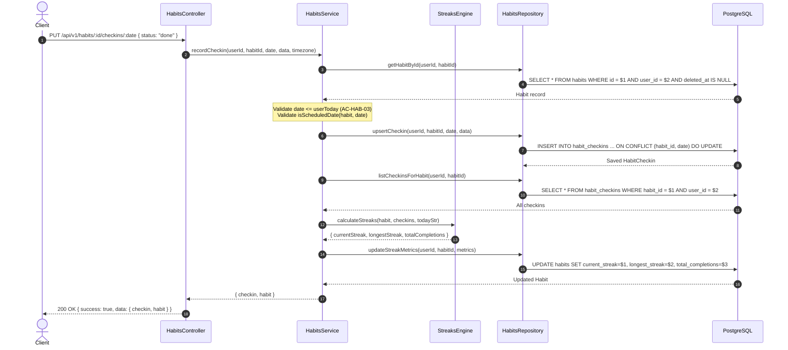

# Architecture Documentation — Habits & Daily Progress

**Phase:** P5 — Habits & Daily Progress  
**Status:** Implemented & Verified  
**Date:** 2026-09-28  
**Specification Reference:** LifeStyle App Specification v1.0.1 (Sections 1.4.6, 6.5, 14.8, 18)

---

## 1. Executive Summary

Phase P5 delivers the complete habit tracking and daily progress engine of the LifeStyle App. It provides production-ready domain services, repositories, controllers, validations, and a pure functional streak engine for:
1. **Habits Management (`/api/v1/habits`)**: Habit definitions with flexible recurrence schedules (`daily`, `weekly`, `monthly`, `days_per_week`, `days_per_month`), color, icons, time of day, and target values.
2. **Check-ins & Streaks (`/api/v1/habits/{id}/checkins/{date}`)**: Atomic daily check-in recording, updating, toggling, and deletion with instant transactional recalculation of `current_streak`, `longest_streak`, and `total_completions`.
3. **Streak Calculation Engine (`streaks-engine.ts`)**: Pure functional, timezone-aware, rule-based calculation enforcing Neutral Skips (skips neither increment nor break streaks), weekly/monthly schedule evaluations, and longest streak historical scans.
4. **Daily Progress Dashboard (`/api/v1/habits/progress/today`)**: Daily habit dashboard evaluating active scheduled habits, individual completion statuses, and overall completion rate derived from `done / (scheduled - skipped)`.
5. **Soft Deletion & Lifecycle (`/api/v1/habits/{id}`)**: Soft-deletion with 30-day restore window, archival toggling, and query isolation.

All implementations strictly adhere to the specification v1.0.1, PostgreSQL 16 single-source-of-truth architecture, composite-key cross-tenant isolation, and zero-leakage security boundaries.

---

## 2. Domain Models & Storage

### 2.1 Database Schema

Habit and check-in tables are modeled in PostgreSQL with composite keys guaranteeing tenant isolation at the database constraint level.

```sql
CREATE TABLE habits (
  id UUID NOT NULL DEFAULT gen_random_uuid(),
  user_id UUID NOT NULL REFERENCES users(id) ON DELETE CASCADE,
  title VARCHAR(255) NOT NULL CHECK (char_length(btrim(title)) >= 1),
  description VARCHAR(2000),
  color VARCHAR(7) NOT NULL DEFAULT '#4F46E5' CHECK (color ~* '^#[0-9A-Fa-f]{6}$'),
  icon VARCHAR(100),
  frequency_type habit_frequency_type NOT NULL DEFAULT 'daily',
  recurrence_rule JSONB NOT NULL DEFAULT '{"frequencyType":"daily"}'::jsonb,
  target_per_day INTEGER NOT NULL DEFAULT 1 CHECK (target_per_day >= 1),
  unit VARCHAR(50) NOT NULL DEFAULT 'times',
  time_of_day TEXT CHECK (time_of_day IN ('anytime', 'morning', 'afternoon', 'evening')),
  reminder_time TIME,
  start_date DATE NOT NULL,
  end_date DATE,
  is_archived BOOLEAN NOT NULL DEFAULT false,
  sort_order INTEGER NOT NULL DEFAULT 0,
  current_streak INTEGER NOT NULL DEFAULT 0 CHECK (current_streak >= 0),
  longest_streak INTEGER NOT NULL DEFAULT 0 CHECK (longest_streak >= 0),
  total_completions INTEGER NOT NULL DEFAULT 0 CHECK (total_completions >= 0),
  created_at TIMESTAMPTZ NOT NULL DEFAULT NOW(),
  updated_at TIMESTAMPTZ NOT NULL DEFAULT NOW(),
  deleted_at TIMESTAMPTZ,
  CONSTRAINT pk_habits PRIMARY KEY (id),
  CONSTRAINT uq_habits_id_user_id UNIQUE (id, user_id),
  CONSTRAINT chk_habits_date_range CHECK (end_date IS NULL OR end_date >= start_date)
);

CREATE TABLE habit_checkins (
  id UUID NOT NULL DEFAULT gen_random_uuid(),
  habit_id UUID NOT NULL,
  user_id UUID NOT NULL,
  date DATE NOT NULL,
  status habit_checkin_status NOT NULL DEFAULT 'done',
  value NUMERIC(10, 2),
  notes VARCHAR(1000),
  created_at TIMESTAMPTZ NOT NULL DEFAULT NOW(),
  updated_at TIMESTAMPTZ NOT NULL DEFAULT NOW(),
  CONSTRAINT pk_habit_checkins PRIMARY KEY (id),
  CONSTRAINT uq_habit_checkins_habit_date UNIQUE (habit_id, date),
  CONSTRAINT fk_habit_checkins_habits FOREIGN KEY (habit_id, user_id)
    REFERENCES habits (id, user_id) ON DELETE CASCADE
);
```

### 2.2 Key Architectural Highlights of the Schema

1. **Composite Ownership Foreign Key**:
   `fk_habit_checkins_habits FOREIGN KEY (habit_id, user_id) REFERENCES habits (id, user_id)` ensures that check-ins can never be inserted or linked across different tenant boundaries.
2. **Deterministic Daily Uniqueness**:
   `UNIQUE (habit_id, date)` enforces that at most one check-in record exists per habit per calendar day. Repeated check-ins on the same date invoke PostgreSQL `ON CONFLICT (habit_id, date) DO UPDATE` for idempotent upsert semantics.
3. **Denormalized Streak Metrics**:
   `current_streak`, `longest_streak`, and `total_completions` are maintained directly on the `habits` record. Whenever a check-in is inserted, updated, or removed, the streak engine recalculates these values and persists them within the same atomic transaction.

---

## 3. Pure Functional Streak Engine

The core streak logic resides in `src/features/habits/streaks-engine.ts`, completely decoupled from database queries or I/O. This makes it deterministic, easily testable across edge cases, and performant.

### 3.1 Frequency & Scheduling Logic

A habit is evaluated for whether it was scheduled on calendar date $D$ based on its recurrence rule:

| Frequency Type | Rule Specification | Scheduled When |
| :--- | :--- | :--- |
| `daily` | `interval: N` (default 1) | `(daysDifference(D, startDate) % interval) === 0` |
| `weekly` | `daysOfWeek: [1..7]` (1=Mon, 7=Sun) | `daysOfWeek.includes(isoDayOfWeek(D))` |
| `monthly` | `daysOfMonth: [1..31]` | `daysOfMonth.includes(D.day)` |
| `days_per_week` | `targetDays: N` | Evaluated against completed count in ISO week |
| `days_per_month` | `targetDays: N` | Evaluated against completed count in calendar month |

Boundary condition: Dates strictly prior to `startDate` or after `endDate` are never scheduled.

### 3.2 Neutral Skips Rule (FR-HAB-05, AC-HAB-02)

The specification explicitly requires that "Neutral Skips" maintain streak continuity:
- **`done`**: Increments streak count.
- **`skip`**: **Neutral.** Preserves current streak continuity without incrementing count and without breaking the streak.
- **`fail`**: Breaks streak immediately (streak resets to 0).
- **Unchecked scheduled day in the past**: Breaks streak immediately.

#### Example Walkthrough
Given a daily habit scheduled every day:
- Day 1: `done` (Streak = 1)
- Day 2: `done` (Streak = 2)
- Day 3: `skip` (Streak = 2 — continuity maintained!)
- Day 4: `done` (Streak = 3)
- Day 5: `fail` (Streak = 0 — broken)

### 3.3 Current Streak Calculation Algorithm

1. Determine `today` in the user's local timezone (via `getUserTodayDate(timezone)`).
2. Scan backwards day by day from `today`:
   - If the date is not scheduled, skip backwards without penalizing.
   - If `today` is scheduled but not checked in yet, look back starting from `yesterday` (allowing the user until end-of-day to complete today's habit).
   - If a scheduled day has `status === 'done'`, increment `currentStreak` and continue scanning backwards.
   - If a scheduled day has `status === 'skip'`, leave `currentStreak` unchanged and continue scanning backwards.
   - If a scheduled day has `status === 'fail'` or is missing a check-in in the past, stop the backward scan.
3. Stop backward scan if reaching `startDate` or exceeding 365 days.

### 3.4 Longest Streak Calculation Algorithm

1. Collect all calendar days from `startDate` up to `today`.
2. Filter for scheduled days.
3. Traverse chronologically:
   - On `done`: Increment rolling streak. If rolling streak > `longestStreak`, update `longestStreak`.
   - On `skip`: Maintain rolling streak (skip neither resets nor increments).
   - On `fail` or missing scheduled day: Reset rolling streak to 0.
4. Ensure `longestStreak = Math.max(longestStreak, currentStreak)`.

---

## 4. Daily Progress Dashboard Engine

### 4.1 Specification Formula (FR-HAB-06, AC-HAB-04)

The completion rate for a given date is computed as:

$$\text{completionRate} = \frac{\text{totalDone}}{\text{totalScheduled} - \text{totalSkipped}}$$

### 4.2 Edge Case Guarantees

1. **Division by Zero**: If `(totalScheduled - totalSkipped) <= 0`, `completionRate` is `0`.
2. **Archived / Deleted Habits**: Only non-deleted (`deleted_at IS NULL`) and active habits (`is_archived = false`) are included.
3. **Date Bounds**: Habits are filtered to those where `startDate <= targetDate` and (`endDate IS NULL OR endDate >= targetDate`).
4. **Rounding**: Completion rate is rounded to 4 decimal places for clean client rendering.

---

## 5. Check-In Upsert & Lifecycle Workflows



---

## 6. Multi-Tenancy & Security Invariants

1. **Composite Key Tenant Scoping**:
   All repository operations query against `(id, user_id)` or `(habit_id, user_id)`. Cross-user inspection or manipulation is physically prevented.
2. **404 Not Found for Foreign Entities**:
   If a user requests a habit ID belonging to another tenant or non-existent, the API returns `404 Not Found` with zero information leakage.
3. **Soft-Delete 30-Day Window Enforcement**:
   Soft-deleted habits are marked with `deleted_at = NOW()`. Restoration endpoint `/api/v1/habits/{id}/restore` checks:
   - If not found or not deleted: `404 Not Found`.
   - If `deleted_at < NOW() - INTERVAL '30 days'`: `410 Gone (RESTORE_WINDOW_EXPIRED)`.
   - If within 30 days: `deleted_at = NULL` and returns restored entity.
4. **Future Date Prevention**:
   Check-ins for dates beyond `getUserTodayDate(userTimezone)` are rejected with `400 Bad Request` (`CANNOT_CHECKIN_FUTURE_DATE`).

---

## 7. Testing & Verification Summary

The Habits domain is verified across two comprehensive test suites:
- **Unit Suite (`tests/unit/streaks-engine.test.ts`)**: 11 table-driven tests verifying streak math, neutral skip continuity, failure resets, weekly/monthly scheduling, edge cases around today's completion status, and division-by-zero protection.
- **Integration Suite (`tests/integration/habits-flow.test.ts`)**: 8 end-to-end HTTP integration tests against live PostgreSQL verifying CRUD, check-in upsert/toggle/delete, soft-delete and 30-day restore, daily progress endpoint, future date rejection, and multi-tenant isolation.
