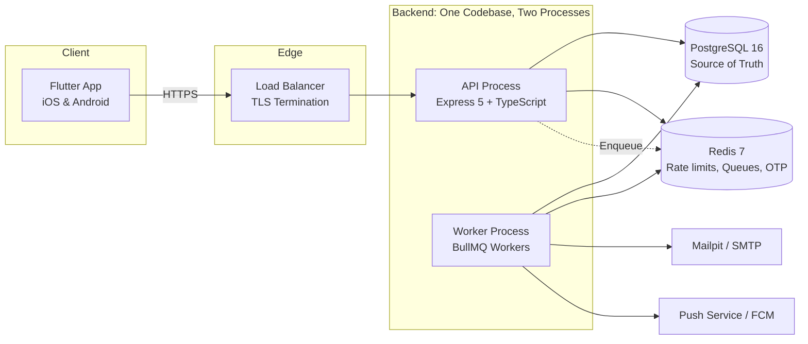

# System Architecture Overview

> **Specification Reference:** Section 4.1 & ADR-001–003

## 1. High-Level Topology

The LifeStyle App backend operates as a single codebase with two executable process targets:
1. **API Process (`server.ts`):** Serves stateless HTTP/HTTPS REST traffic from mobile native clients.
2. **Worker Process (`worker.ts`):** Consumes asynchronous queues (BullMQ), runs scheduled tasks, executes maintenance sweeps, and dispatches background reminders.

---

## 2. Component Responsibilities

| Component | Responsibility | Constraints |
| :--- | :--- | :--- |
| **Flutter App** | Native mobile UI, offline local view state, token storage | No browser runtime, no cookies, Bearer tokens only |
| **API Process** | Input validation, ownership authorization, transaction execution | Stateless, horizontally scalable, max 30s drain |
| **Worker Process** | Asynchronous job execution, reminder dispatching, retention purging | Idempotent consumers, isolated DB connections |
| **PostgreSQL 16** | Sole source of truth for all business entities | ACID, composite FKs, soft deletes, least-privilege roles |
| **Redis 7** | Ephemeral infrastructure state | Safe to lose/rebuild; strictly zero primary business data |

### 2.1 Reminder Delivery Model (ADR-044 guardrail, R-04)

| Channel | Server behavior | Client behavior |
| :--- | :--- | :--- |
| `in_app` (default) | Reminder row becomes visible through the reminders API | App schedules a local notification from the due reminder |
| `email` | Worker dispatches via SMTP (nodemailer, TLS) with 5 attempts | n/a |
| `push` | **Stub in this phase**: the sender always fails with `PUSH_UNAVAILABLE` after retries; FCM credentials are optional (Phase P1) | The shipped client requests `in_app` for every event reminder |

Until FCM credentials are configured and a push provider is wired into
`worker.ts`, push-channel reminders are created but end failed after
their retry budget. On-device local notifications keep the user-facing
reminder experience intact in the meantime.

---

## 3. Core Operating Loop

The system enables the five-step productivity loop:
* **PLAN:** Daily Plan, Calendar Events, Projects, Goals, Recurring Tasks.
* **FOCUS:** Active task execution, single running Timer Session per user.
* **DO:** Task completions, Habit check-ins, Notes capture.
* **TRACK:** Streaks, milestones, money transactions, subscription renewals.
* **REVIEW:** Aggregated Dashboard metrics, financial summaries, progress tracking.
