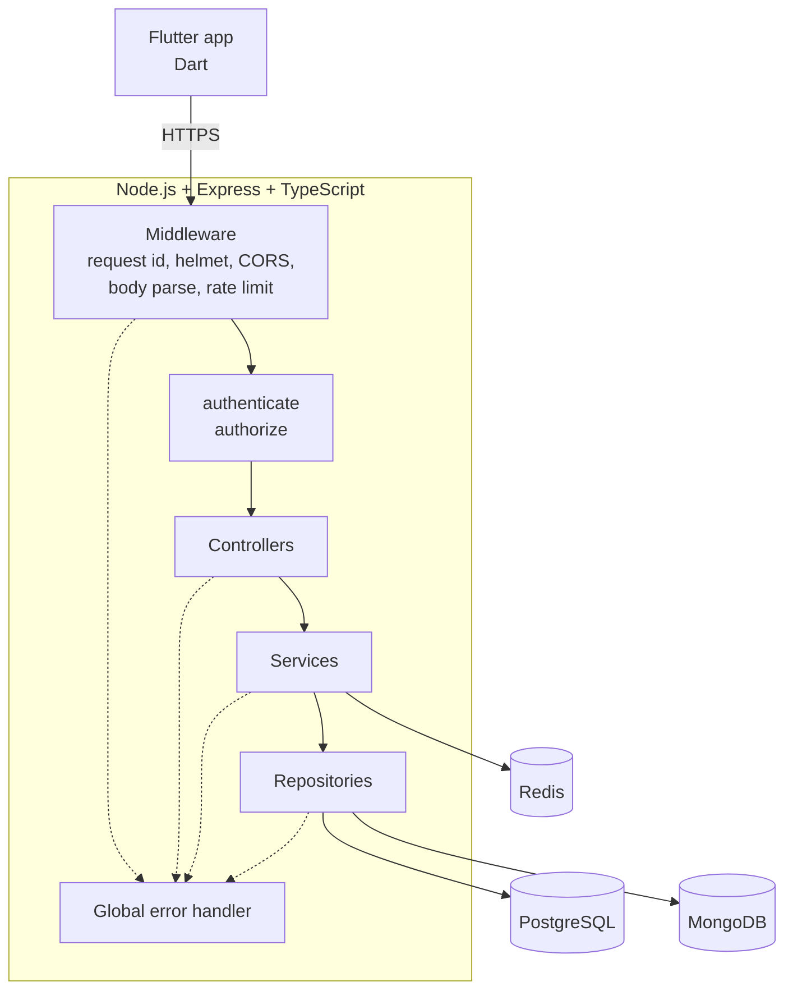
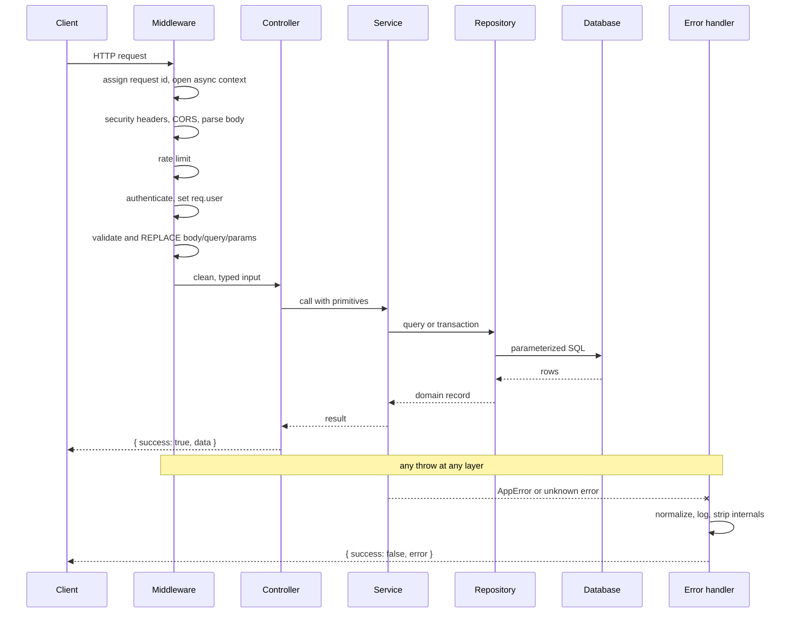
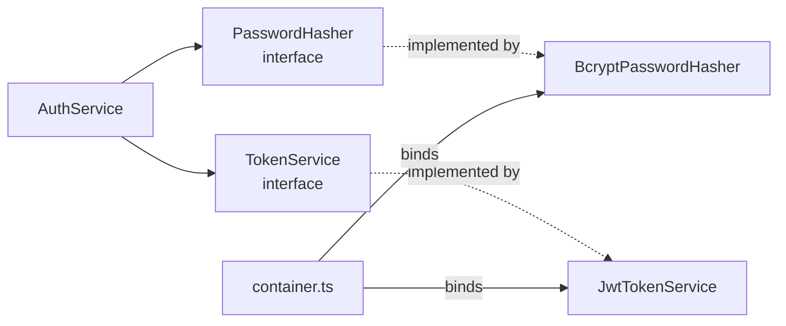

# System architecture



Every failure path converges on one error handler, which is what makes the
response shape uniform and makes it impossible to leak internals from a forgotten
catch block.

## Layers and what belongs in each

| Layer | Responsibility | Must not |
|---|---|---|
| Route | Wire path to middleware chain and controller | Contain logic |
| Middleware | Cross-cutting concerns: identity, validation, limits | Know about a feature's domain |
| Controller | Read request, call service, send response | Contain business rules or touch a database |
| Service | Business rules, orchestration, transactions | Know about HTTP |
| Repository | Queries and persistence | Contain business rules or perform authorization |

The one deliberate exception: repositories push ownership predicates into their
WHERE clauses. That is authorization leaking downward on purpose, because a
filter the database applies cannot be forgotten at a new call site.

## Request lifecycle



The correlation id assigned in the first step is carried by async context, so
every log line from every layer of that request shares it without any function
needing a `requestId` parameter.

## Feature layout

```
src/
├── config/          validated environment, single source
├── core/
│   ├── errors/      AppError, code catalogue, normalization
│   ├── logger/      Pino, redaction, async request context
│   ├── middleware/  request id, auth, validate, rate limit, error handler
│   ├── security/    password hasher, token service, HTTP headers
│   ├── utils/       response envelope
│   └── container.ts composition root
├── infrastructure/
│   └── database/
│       ├── postgres/  pool, transactions, migrations
│       ├── mongodb/   connection, models, audit writer
│       └── redis/     client, cache helpers
├── features/
│   ├── auth/        controller, service, repository, routes, validation, types, mapper
│   ├── health/      liveness and readiness
│   └── docs/        Swagger UI
├── app.ts
└── server.ts
```

A feature owns its full vertical slice. There is no global `controllers/` or
`models/` directory, which is what the specification means by feature-based.

## Dependency inversion in practice



`AuthService` never imports bcrypt or jsonwebtoken. `container.ts` is the only
file that binds an interface to an implementation, so swapping bcrypt for argon2
is one line there. Tests exploit the same seam to inject fast fakes.
