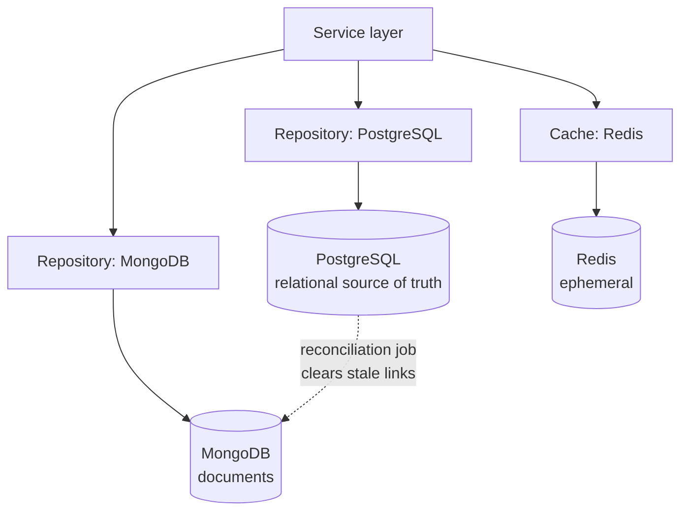
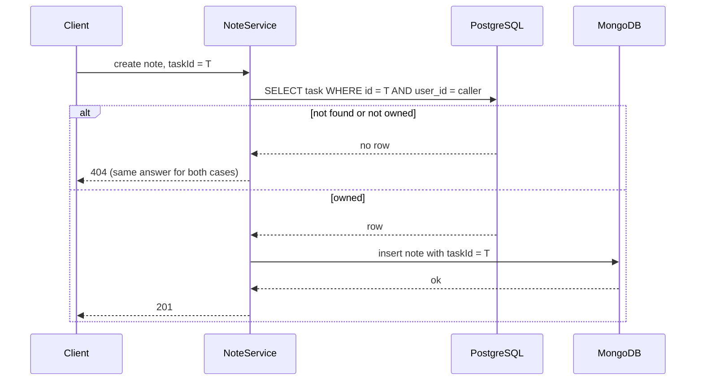

# Database architecture

Three stores, each with a defined job. The governing rule from the technical
specification: for every piece of data, name a source of truth, a database, a
reason, and a consistency requirement.

## Responsibility table

| Data | Source of truth | Why | Consistency requirement |
|---|---|---|---|
| Users, credentials | PostgreSQL | Unique email, referential parent of everything | Strong. ACID |
| Refresh tokens | PostgreSQL | Must be revocable instantly and atomically rotated | Strong. ACID |
| Projects, tasks, timer sessions | PostgreSQL | Foreign keys, ownership, status constraints | Strong |
| Habits, habit logs | PostgreSQL | One row per habit per day is a unique constraint | Strong |
| Goals, milestones | PostgreSQL | Relational, optional link to a task | Strong |
| Expenses, subscriptions, budgets | PostgreSQL | Exact decimal money, ACID, aggregate reporting | Strong. Non-negotiable |
| Events, reminders | PostgreSQL | Event and its default reminder must commit together | Strong. ACID |
| **Notes** | **MongoDB** | Variable shape, free-form body, arbitrary tags, attachments planned | Eventual against PostgreSQL links |
| **Audit log** | **MongoDB** | Append-only, per-event-type metadata, high write volume | Eventual. Best effort |
| Cache entries | Redis | Derived, reconstructible | None. Loss costs latency only |
| Rate-limit counters | Redis | Shared across instances, short-lived | None |
| Revoked-session markers | Redis | Short-lived, expires with the access token | None. Fails safe |

Nothing appears twice as a source of truth. Notes hold references to PostgreSQL
rows, but PostgreSQL never holds note content.

## Why money is in PostgreSQL, specifically

Amounts use `NUMERIC(14,2)`, never a floating-point type. Binary floating point
cannot represent 0.10 exactly, so sums drift and a spending report stops
reconciling against the expenses that produced it. This is the single clearest
example of choosing a database for a correctness requirement rather than a
storage requirement.

That decision only holds if nothing later undoes it, and the obvious place to undo
it is on the way out: `JSON.parse` turns a JSON number into a double, so an API
that publishes `{"amount": 1234.5}` has thrown away the guarantee the column type
bought. Amounts therefore stay strings from the driver to the response, and every
sum, difference and percentage is computed by PostgreSQL rather than in
JavaScript. See DD-021.

Five read-time derivations follow from the same principle of not storing what can
be computed:

| Value | Derived from | Why not stored |
|---|---|---|
| A budget's spending | The expenses matching its month, category and currency | A counter must be adjusted by every expense write, and an edit moves an expense between two budgets |
| A subscription's next renewal | Its stored anchor date and today | Rolling the date forward needs a daily job, which is stale the first time it misses a run |
| A budget's percentage and remaining | Its limit and that sum | Two numbers that can disagree are worse than one that is recomputed |
| Which reminders are due | `status`, `remind_at` and `now()`, at the moment of asking | A queue a worker drains has to survive the worker being down; a query does not (DD-025) |
| A polymorphic reference's title | The table its discriminator names, in the same statement | A copied title goes stale silently; a null one is how a deleted target is reported (DD-026) |
| The whole home summary | Eight tables, in one statement, per request | A cached summary must be dropped by every write path in every feature, and the first one that forgets contradicts the screen the user just came from (DD-027) |

### The foreign key PostgreSQL cannot declare

Two columns in this schema point at a row whose TABLE is chosen by a sibling
column: `events.linked_type` + `linked_id`, and `reminders.entity_type` +
`entity_id`. No `REFERENCES` clause can express that, so the constraints that
remain are the ones the database can still enforce, and the rest is code:

| What a foreign key would do | Where it happens instead |
|---|---|
| Restrict the discriminator | `CHECK (... IN ('task', 'habit', ...))`, in the migration |
| Forbid half a reference | `CHECK ((type IS NULL AND id IS NULL) OR (both NOT NULL))` |
| Reject a target that does not exist | One query in the service, before the write, which is also the ownership check |
| Resolve the reference on read | A `CASE` of correlated subqueries in the same statement, every branch scoped to the owner |
| Cascade on delete | Written out for events and their reminders, in one transaction. Not possible across slices — a deleted task leaves reminders behind, which are filtered out of delivery and reported as dangling |

The partial unique index on reminders is worth naming too:
`(entity_type, entity_id, remind_at) WHERE status = 'pending'`. It is what stops
the same thing being announced twice at the same instant, and it is partial so a
long history of sent reminders does not occupy the index or block a legitimate
re-schedule onto an instant that has already passed.

## Why notes are in MongoDB

A note today is a title, a body and a tag list. The roadmap adds attachments and
rich content blocks. In PostgreSQL that is either:

- a `note_tags` join table and a `note_blocks` table, so reading one note costs
  three joins and adding a block type is a migration, or
- a JSONB column, which is a document store with a relational wrapper around it.

Neither is wrong. Given the specification requires MongoDB where the data suits
it, this is the entity where that is genuinely true.

## The cross-database boundary

A note carries `userId`, `projectId` and `taskId` as plain strings. These point
at PostgreSQL rows, and **there is no foreign key**, because there cannot be one.

The existence check and the ownership check are the same query. A note therefore
cannot be attached to another user's task. The failure is a 422 naming the field,
with a message identical whether the task is missing or belongs to someone else,
so task ids cannot be enumerated through it (DD-014).

**What happens when the task is later deleted.** Nothing immediately. PostgreSQL
has no way to cascade into MongoDB. The note keeps a `taskId` that no longer
resolves. Reads treat an unresolvable link as unlinked, so the user sees a note
with no task attached rather than an error. Resolution is two bulk queries per
page, not one per note.

`POST /api/v1/notes/reconcile` clears the stale field for good. It is idempotent:
a second run reports zero. It is scoped to the calling user, so it can run on
demand for one account and on a schedule for all of them once the job runner
exists. Full reasoning in DD-015.

While a note is unreconciled the stored id is still there, so filtering by the
deleted task's id still matches a note whose response shows `taskId: null`. That
is the visible cost of two databases, and it is bounded by how often
reconciliation runs.

**What is explicitly NOT claimed.** A write touching both databases is not
atomic. There is no distributed transaction. If the process dies between the
PostgreSQL check and the MongoDB insert, no note is created, which is the
harmless direction. The dangerous direction, a note referencing a task that was
deleted concurrently, is handled by tolerant reads plus reconciliation.

## The notes collection

| Index | Serves |
|---|---|
| `{ userId, isArchived, createdAt }` | Every listing. All three are equality or sort conditions in every query |
| `{ userId, tags }` | Tag filtering. Multikey: MongoDB indexes each array element |
| `{ userId, taskId }` sparse | Notes attached to one task |
| `{ userId, projectId }` sparse | Notes attached to one project |

Every index leads with `userId`, because every query filters on it and an index
that did not would be unusable for the one condition that is never optional.

There is deliberately **no text index**. Search is a literal case-insensitive
substring match, because a search box is expected to find "project" from "proj"
and `$text` matches whole stemmed words. The search term is escaped before it
becomes a regular expression, so `c++` searches for itself and `(a+)+$` cannot
burn CPU through catastrophic backtracking. Reasoning and the cost of that choice
are in DD-016.

The schema uses `strict: 'throw'`: a field the schema does not declare is an
error, not a silently stored document. Combined with `strictQuery` and Zod
validation at the edge, that is three independent layers between a request body
and a stored document.

## Redis usage

| Key pattern | Holds | TTL | Invalidated by |
|---|---|---|---|
| `lifestyle:v1:revoked-session:<sessionId>` | Revocation marker | Access token lifetime | Expiry |
| `lifestyle:v1:ratelimit:<scope>:<key>` | Request counters | Window length | Expiry |

That is the whole list, and it is shorter than it was. A `user` projection key
and a `dashboard` key were designed here before either feature existed. Eleven
services grew a call invalidating the first one; nothing ever wrote it, so every
create, update and delete in the application was paying for a Redis round trip
that could not hit anything. Both keys and all eleven calls are gone, and
DD-027 records why the home summary is computed per request instead.

The rule this leaves behind: **a key belongs in this table when something reads
it.** Designing the cache before the feature produced two keys that were never
read and one invalidation path that looked, in review, exactly like a working
cache.

Every user-scoped key contains the user id. That is a security control, not an
organizing convenience: a cache keyed only by resource id serves one user's data
to another the moment two users request the same path.

Never cached: passwords, password hashes, tokens, secrets.

The `v1` segment is a schema version. Bumping it invalidates every key at once,
which is cheaper and safer than a migration script after a shape change.

## Operational consequences of running two databases

Stated so they are not discovered later:

- Two backup regimes. A PostgreSQL restore does not restore notes.
- A point-in-time restore of one database without the other can resurrect a note
  whose task is gone, or vice versa. The reconciliation job is what makes that
  survivable.
- Two sets of credentials to rotate.
- Readiness reports them separately, and MongoDB being down degrades notes and
  the audit trail without taking the instance out of rotation.
