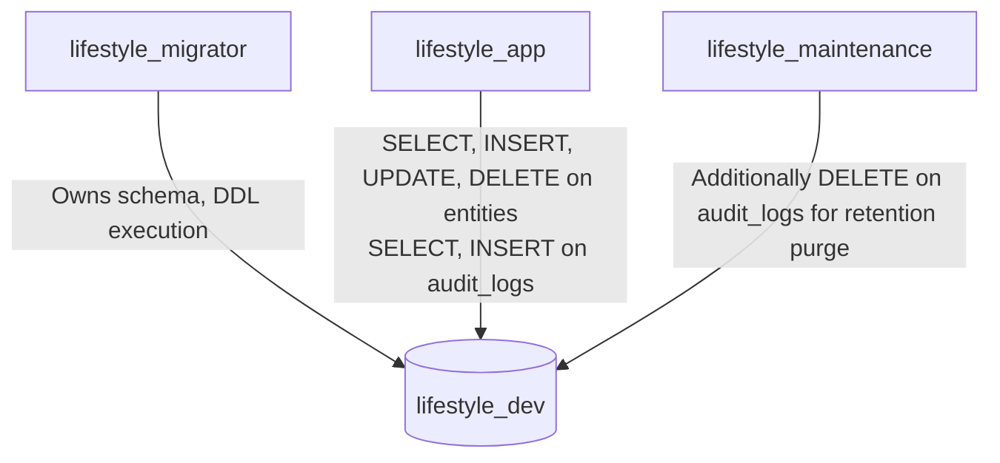

# Database Architecture & Source of Truth

> **Specification Reference:** Section 5 & 6

## 1. Absolute Source of Truth

PostgreSQL 16 is the **sole source of truth** for all business data in the LifeStyle App MVP:

* Every user-owned table carries a `user_id` column.
* Composite unique constraints `UNIQUE(id, user_id)` and composite foreign keys `FOREIGN KEY (child_ref, user_id) REFERENCES parent(id, user_id)` guarantee that cross-user data associations are impossible at the database engine level.
* Soft deletes are used for aggregate roots (`deleted_at`), while children cascade cleanly.
* Money is stored strictly in `numeric(19,4)` columns.

---

## 2. Least-Privilege Database Roles (Section 6.11)

Access to PostgreSQL is segregated into three dedicated roles:

| Role Name | Used By | Allowed Privileges | Forbidden Operations |
| :--- | :--- | :--- | :--- |
| `lifestyle_migrator` | Migration runner only | `CREATE`, `ALTER`, `DROP`, owns schema `public` | Not used by running API server |
| `lifestyle_app` | API and Worker processes | `SELECT`, `INSERT`, `UPDATE`, `DELETE` on entity tables; `SELECT`, `INSERT` on `audit_logs` | No DDL, no `DELETE` on `audit_logs` |
| `lifestyle_maintenance` | Worker retention purge job | Additionally `DELETE` on `audit_logs` where `created_at < now() - INTERVAL '12 months'` | General API traffic |

---

## 3. Database Entity Responsibilities (22 MVP Tables)

* **Identity:** `users`, `auth_sessions`, `refresh_tokens`, `push_devices`
* **Planning:** `projects`, `tasks`, `recurrences`, `recurring_tasks`, `timer_sessions`
* **Habits & Goals:** `habits`, `habit_checkins`, `goals`, `milestones`
* **Notes:** `notes`, `note_links`
* **Money:** `categories`, `transactions`, `subscriptions`, `budgets`
* **Time:** `events`, `reminders`
* **Audit & Retention:** `audit_logs`
