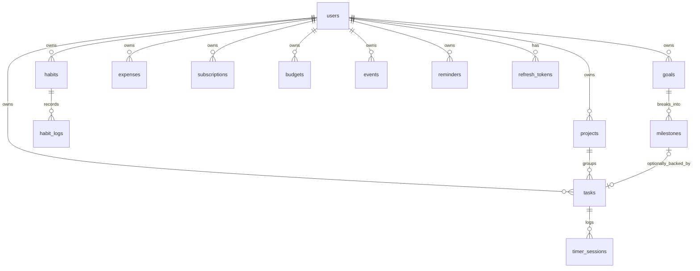

# Schema reference

PostgreSQL tables are defined by the migrations in
`backend/src/infrastructure/database/postgres/migrations/`. Those files are the
authority; this page explains intent and the non-obvious constraints.

## Entity relationships

Notes live in MongoDB and reference `users`, `projects` and `tasks` by id. They
are absent from this diagram because the relationship is not enforced by the
database.

## Constraints that encode business rules

These exist so that a rule cannot be broken by a bug in a service, or by a second
client written later.

| Table | Constraint | Rule it enforces |
|---|---|---|
| `users` | `users_password_hash_is_hashed` | A bcrypt hash is 60 characters. A plaintext password cannot be stored |
| `users` | `users_email_is_lowercase` | Case-insensitive uniqueness without the citext extension |
| `users` | unique index on `email` | Two concurrent signups cannot both succeed |
| `tasks` | `tasks_recurrence_rule_present` | A recurring task must have a rule; a non-recurring one must not |
| `tasks` | `tasks_completed_matches_status` | `completed_at` is set if and only if status is done |
| `timer_sessions` | `timer_sessions_one_running_per_task` | A partial unique index: at most one session with a null end time |
| `habit_logs` | unique on `(habit_id, log_date)` | One row per habit per day, so streak counts cannot double |
| `budgets` | `budgets_month_is_first_day` | The scoping convention holds for every row |
| `expenses` | `amount > 0` and `NUMERIC(14,2)` | Exact decimal money, no negative expenses |
| `events` | `events_link_is_complete` | A polymorphic reference is whole or absent, never half |
| `reminders` | `reminders_no_duplicate_pending` | The same entity cannot queue two identical pending reminders |
| `refresh_tokens` | `char_length(token_hash) = 64` | Only a SHA-256 digest can be stored, never a raw token |

## Polymorphic references

`reminders.entity_type` / `entity_id` and `events.linked_type` / `linked_id` are
the dashed lines in the ERD. The target table varies per row, so a foreign key is
impossible.

What the database still enforces:

- The discriminator is restricted to a known set by a CHECK constraint.
- The pair is all-or-nothing: a type with no id, or an id with no type, is
  rejected.

What the application must enforce, because the database cannot:

- That the referenced row actually exists.
- That it belongs to the same user.

Both checks run in the service before the write.

## Index rationale

Indexes are deliberate, not reflexive. Each one below exists for a named query.

| Index | Serves |
|---|---|
| `tasks_user_due_open_idx` (partial) | Home dashboard: today's and overdue tasks. Excludes done rows, which are never in that answer |
| `habit_logs_streak_idx` (partial) | Streak calculation, walking backwards over completed days |
| `reminders_due_idx` (partial) | The delivery worker's only query: pending reminders now due |
| `subscriptions_renewal_idx` (partial) | Renewal reminders across all users, so it leads with the date not the user |
| `expenses_user_category_idx` | Budget progress: a user's spending grouped by category |
| `projects_user_name_key` (unique) | Prevents duplicate project names per user without a racy pre-check |

Partial indexes appear repeatedly because most queries here care about a live
subset: open tasks, pending reminders, active subscriptions. A partial index over
that subset is smaller, faster to scan and cheaper to maintain on write than one
covering every historical row.
