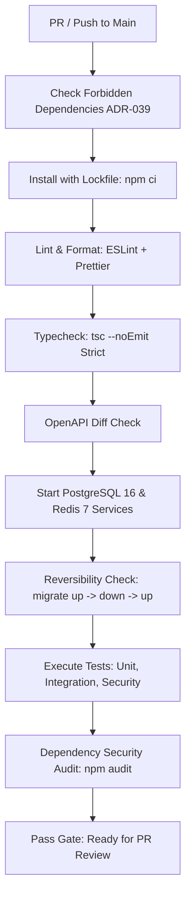

# Continuous Integration & Deployment (CI/CD)

> **Specification Reference:** Section 19.3

## 1. Automated CI Pipeline Overview

The CI pipeline runs on GitHub Actions on every pull request and push to the `main` branch. All checks are required to be green before code can be merged.

---

## 2. Gate Definitions

1. **Forbidden-Dependency Gate:** Scans package manifests, lockfiles, and configs for prohibited technologies (MongoDB, cookies, file uploads, AI, offline databases).
2. **Type Safety Gate:** Strict TypeScript compiler check ensures zero implicit any and strict optional properties.
3. **Migration Reversibility Gate:** Applies all migrations, rolls them back, and reapplies them on an empty test database to guarantee schema rollbacks work in production emergencies.
4. **OpenAPI Drift Gate:** Generates `docs/api/openapi.yaml` from code schemas and compares against the committed version; fails if documentation has drifted from implementation.
5. **Security Test Gate:** Runs dedicated security tests ensuring headers, redaction, and error contracts hold.
