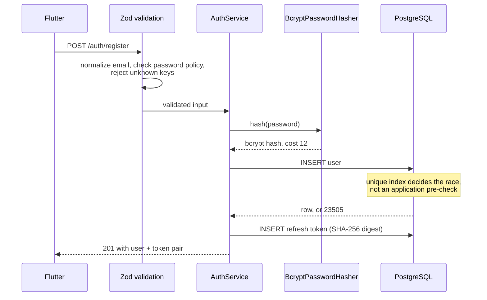
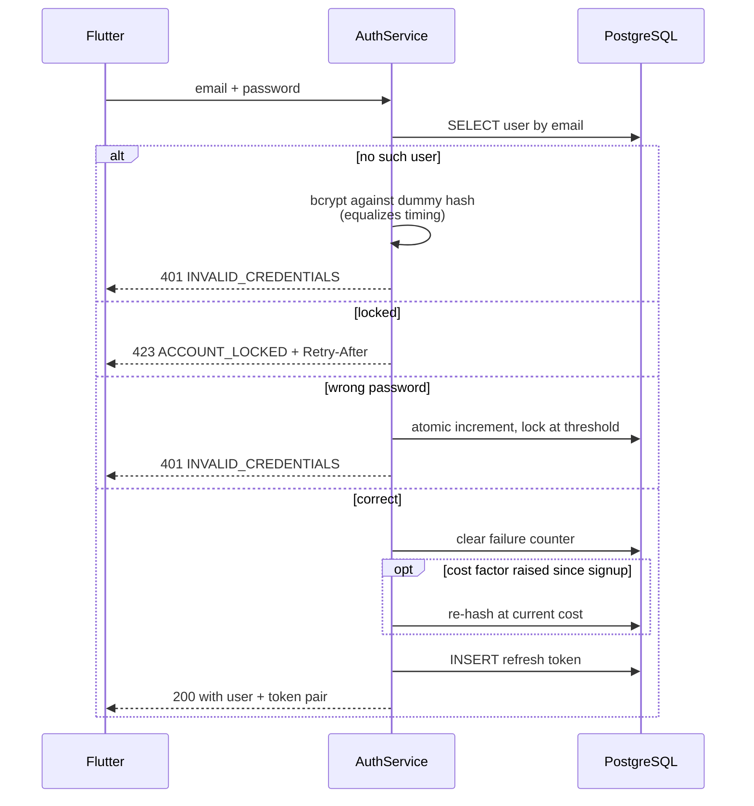
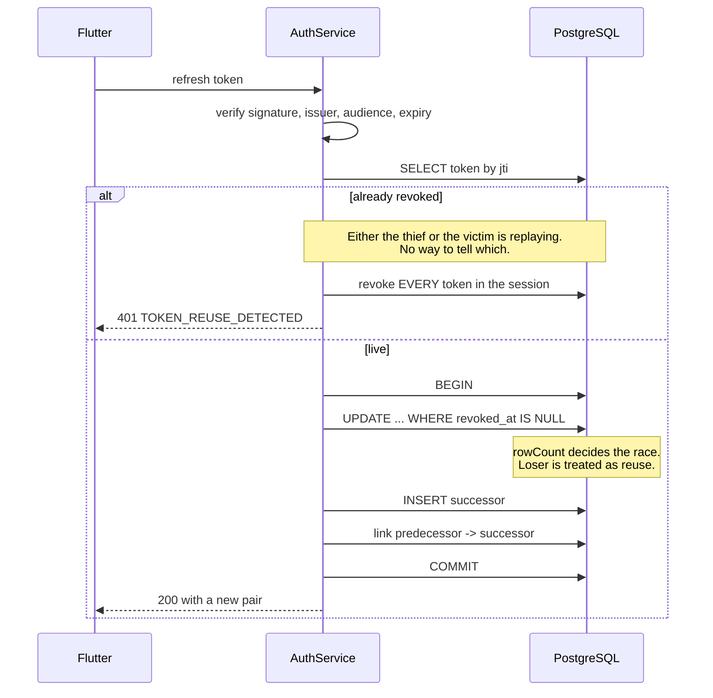

# Authentication flow

## Registration

Uniqueness is left to the database. Checking "does this email exist" first and
inserting afterwards races: two simultaneous signups both pass the check.

## Login

The unknown-user and wrong-password branches return byte-identical responses.

## Refresh with rotation and reuse detection

## Token lifetimes and why they differ

| Token | Lifetime | Stored? | Revocable |
|---|---|---|---|
| Access | 15 minutes | No | Only via the Redis denylist |
| Refresh | 30 days | SHA-256 digest | Immediately, in PostgreSQL |

The access token is stateless so that verifying it costs no database round trip.
The price is that it cannot be truly revoked, which is exactly why its lifetime
is short. The refresh token is stored so a session can be ended instantly.

## What happens when

| Event | Result |
|---|---|
| Access token expires | `TOKEN_EXPIRED`. Client refreshes and retries |
| Refresh token expires | `TOKEN_EXPIRED`. Client must sign in again |
| Refresh token reused | Entire session family revoked. `TOKEN_REUSE_DETECTED` |
| User logs out | Refresh token revoked, cookie cleared, session added to the denylist |
| Password changed | Every session for that user revoked, including the current one |
| Account disabled | Next refresh fails with `ACCOUNT_DISABLED` |
| 5 failed logins | Account locked 15 minutes; correct password also refused |

## Why a password change ends every session

A password change usually follows a suspected compromise. Leaving existing
sessions alive would leave the attacker signed in. Enforced twice: every refresh
token row is revoked, and any token issued before `password_changed_at` fails its
next refresh.

That timestamp comparison is done in **whole seconds**. A JWT `iat` is defined in
seconds while `password_changed_at` keeps millisecond precision, so comparing raw
values made every token issued at registration look older than the password it
was issued with, and the first refresh always failed. This was a real bug, found
by end-to-end testing and fixed; the sub-second window it leaves is covered by
the explicit row revocation.

## Client guidance for Flutter

- Store both tokens with `flutter_secure_storage`, never `SharedPreferences`.
- On `TOKEN_EXPIRED`, refresh once and retry the original request.
- On any other 401, clear stored tokens and return to sign-in.
- On `TOKEN_REUSE_DETECTED`, clear everything and warn the user that the session
  was ended for security reasons.
- Never retry a refresh automatically more than once. A retry loop against a
  rotated token looks exactly like an attack and will burn the session.
